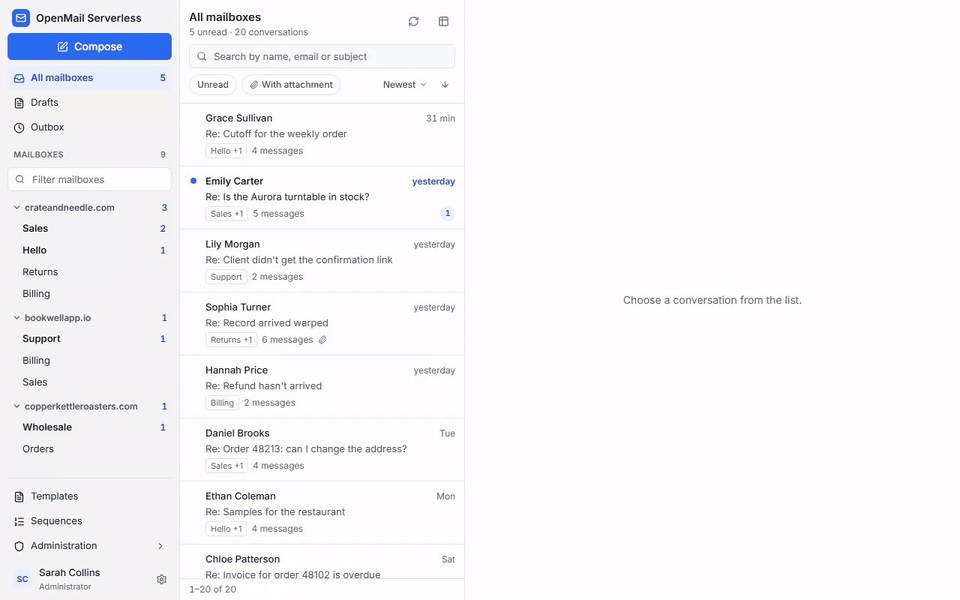
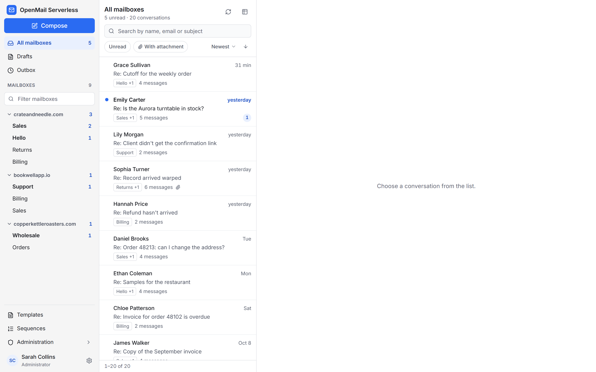
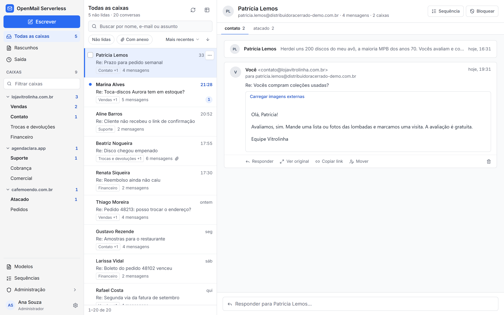
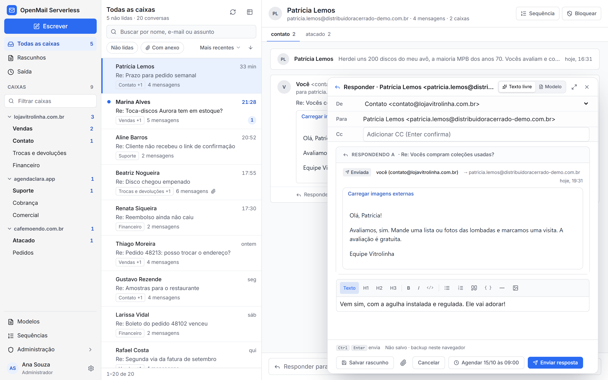
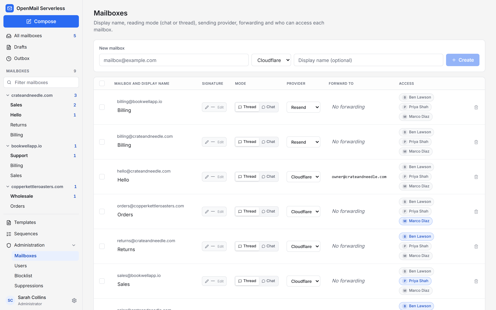
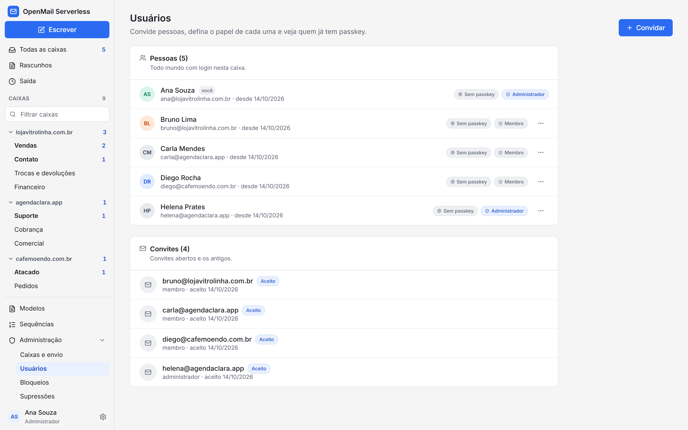
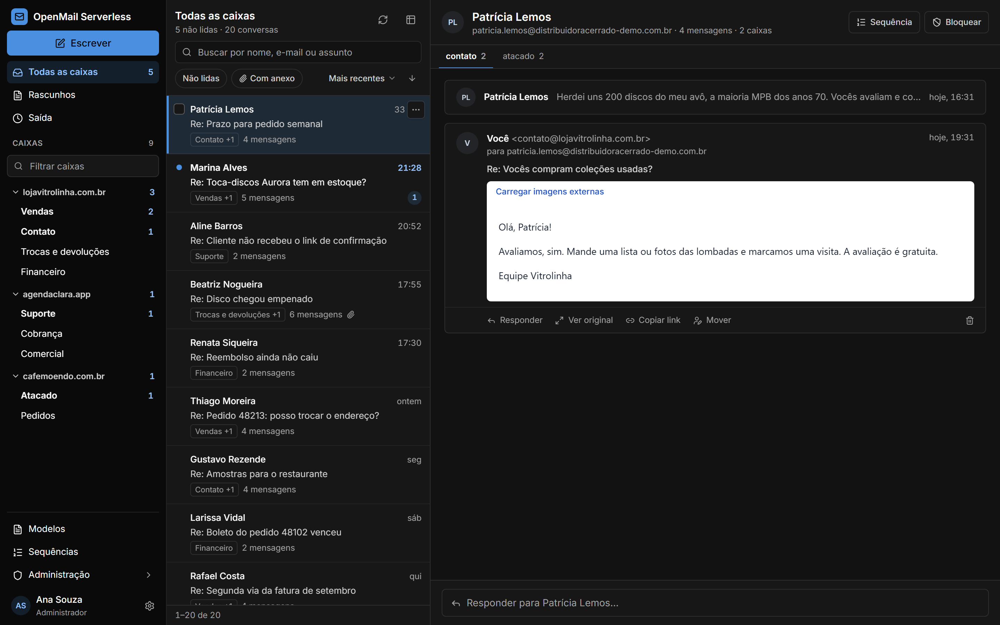
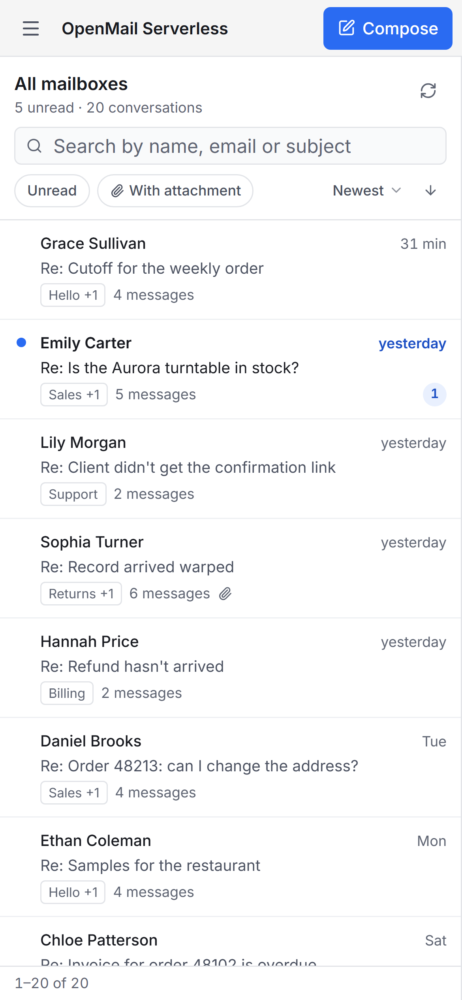
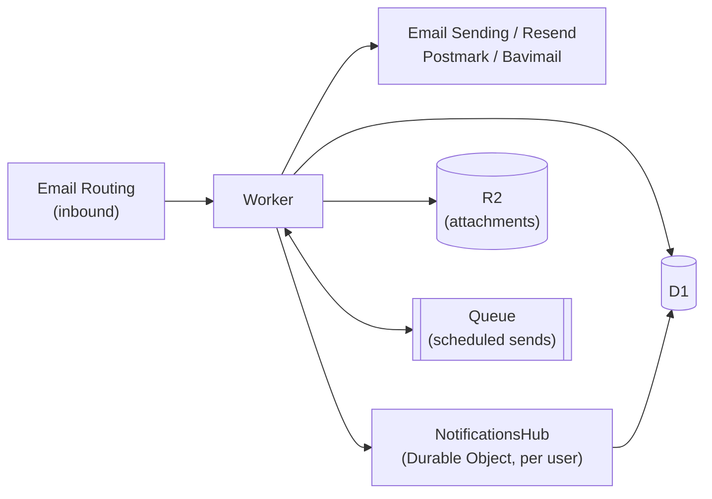

# OpenMail Serverless

**A shared inbox that runs entirely on Cloudflare Workers.** Receive mail on every domain you own, see each customer as one timeline, and reply from the right address, with no mail server, no VM and no per-seat pricing.

<p>
  <a href="LICENSE"></a>
  <a href="https://workers.cloudflare.com/"></a>
  
</p>



[Watch the MP4](docs/screenshots/demo.mp4) (28 seconds). Every domain, person and message in the demo is fictional.

OpenMail Serverless is a fork of [saasmail](https://github.com/choyiny/saasmail) by Cho Yin Yong. It keeps saasmail's architecture and adds a redesigned three-pane inbox, per-sender provider routing, server-side drafts and scheduled sending. The interface ships in **English and Brazilian Portuguese**: it follows the browser language, and anyone can switch under **Settings → Language**.

## Highlights

- **Every domain in one place.** Mailboxes are grouped by domain in the sidebar, with unread counts per domain and per mailbox.
- **One timeline per person.** Marketing, billing and support mail from the same customer land together, split by mailbox.
- **Pick the sender per mailbox.** Send most mail through Cloudflare Email Sending and a few identities through Resend, from the same deployment.
- **Drafts and scheduled replies.** Drafts are saved on the server, the reply box keeps a local backup, and **Schedule** queues a reply for the next business hour.
- **Team access.** Admins see everything; members only see the mailboxes assigned to them.
- **Gmail and Google Workspace.** Connect a Google mailbox over OAuth: its mail lands on an inbox's timeline, and replies leave through that mailbox. See [docs/gmail.md](docs/gmail.md).
- **WebMCP.** A browser AI agent can read the inbox and write drafts as the signed-in user, and never sends or deletes. See [docs/webmcp.md](docs/webmcp.md).
- **English and Portuguese.** The interface follows the browser language and can be switched per browser.
- **About $5 a month.** The Cloudflare Workers Paid plan covers it, including 3,000 outbound emails.

## Screenshots

| Three domains, one inbox                                                                     | Conversation                                                                                                           |
| -------------------------------------------------------------------------------------------- | ---------------------------------------------------------------------------------------------------------------------- |
|                                |                                             |
| **Reply with scheduling**                                                                    | **Mailboxes, providers and access**                                                                                    |
|     |  |
| **Users**                                                                                    | **Dark theme**                                                                                                         |
|  |                                        |

<p align="center"></p>

## Who it is for

Small teams that answer customers from several domains and want to own that mail. If you have domains on Cloudflare and a Workers Paid plan, you can run support, sales and billing mailboxes for all of them from a single Worker.

## Providers

|               | Cloudflare       | Resend | Postmark | Bavimail |
| ------------- | ---------------- | ------ | -------- | -------- |
| **Receiving** | ✅ Email Routing | —      | —        | —        |
| **Sending**   | ✅ Email Sending | ✅     | ✅       | ✅       |

**Receiving** always goes through Cloudflare Email Routing: point each domain's catch-all rule at the Worker and every address on it becomes a mailbox.

**Sending, one provider.** Configure one of these and every mailbox uses it:

- **Cloudflare Email Sending**: add a `send_email` binding named `EMAIL` in `wrangler.jsonc` and onboard the domain at [Email Service](https://dash.cloudflare.com/?to=/:account/email-service).
- **Resend**: set the `RESEND_API_KEY` secret.
- **Postmark**: set the `POSTMARK_API_KEY` secret and verify each sending domain in Postmark.
- **Bavimail**: set the `BAVIMAIL_API_KEY` and `BAVIMAIL_ALIAS_ID` secrets.

When more than one is configured, the precedence is Bavimail, then Postmark, then Resend, then Cloudflare. With none, sending fails with "No email provider configured".

**Sending, per mailbox.** Configure both the `EMAIL` binding and `RESEND_API_KEY`, then set `vars.EMAIL_PROVIDER_ROUTING` to `"identity"`. Each mailbox then picks Cloudflare or Resend on the **Mailboxes** page, and new mailboxes default to Cloudflare. The choice is strict: if the chosen provider is missing its binding or secret, the send fails instead of going out through the other one.

## How it works

```
Inbound    sender ─▶ Cloudflare Email Routing ─▶ Worker ─▶ D1 · R2 · Queue
Outbound   Worker ─▶ Email Sending / Resend / Postmark / Bavimail ─▶ recipient
```

Everything runs inside one Worker.



| Layer             | Technology                                                                            |
| ----------------- | ------------------------------------------------------------------------------------- |
| Receive           | Cloudflare Email Routing → Email Worker                                               |
| Send              | Cloudflare Email Sending, Resend, Postmark or Bavimail                                |
| Runtime and API   | Cloudflare Workers, Hono, Zod OpenAPI (spec at `/doc`, explorer at `/swagger-ui`)     |
| Data              | D1 (SQLite) with Drizzle; R2 for attachments                                          |
| Background work   | Hourly cron for sequences and the outbox (scheduled sends); Queues for sequence steps |
| Realtime and push | `NotificationsHub` Durable Object: WebSockets plus Web Push (VAPID)                   |
| Frontend          | React, Tailwind CSS, TipTap editor                                                    |
| Auth              | Better Auth with passkeys                                                             |

The `NotificationsHub` Durable Object is keyed per user. When mail arrives, the Worker notifies each recipient's hub, which updates open tabs over WebSocket and sends encrypted Web Push to registered devices.

**Latency tip.** Every D1 query is a round trip, and the inbox views make several per request. If your users are far from the database, set `"placement": { "region": "..." }` in `wrangler.jsonc` to the cloud region next to your D1 primary (for example `aws:us-west-1` for WNAM).

## Features

### Inbox

- **Grouped by domain.** The sidebar lists every mailbox under its domain, unread mailboxes first; quiet ones collapse.
- **Three panes.** Mailboxes, conversation list and reading pane side by side on desktop; a drawer below 1024 px. The URL follows the open mailbox and conversation, so links and reloads land in the same place.
- **Per-mailbox reading mode.** **Thread** shows subjects, quoted history and the original HTML; **Chat** strips them for a back-and-forth feel. Pick per mailbox.
- **Attachments** show type, size and a thumbnail; external images stay blocked until you load them.
- **Search and filters** by name, address or subject, unread only, or with attachments.

### Replying

- **Drafts** are saved on the server and marked in the list. The composer also keeps a local backup in the browser until the draft is saved or sent.
- **Schedule** queues the reply for the next business-hour slot. Scheduled mail waits in the **Outbox**, where it can be cancelled, and goes out on the next hourly run.
- **Replies to forwarded mail** go out from the original mailbox.
- **Templates and signatures** per mailbox.

### Per-mailbox forwarding

Give a mailbox a **Forward to** address and every message it receives is re-sent there through your outbound provider. This avoids Cloudflare Email Routing forwarding rules, whose shared IPs are blocklisted by Outlook and Hotmail (`550 5.7.1 … (S3150)`).

- The copy comes **from** the mailbox address, with the original sender in the display name, and carries a signed `Reply-To`. Replying from your personal mailbox sends the answer as the original mailbox and records it in Sent.
- The original `From`, `Date`, `Subject`, `Cc` and SPF/DKIM/DMARC results are listed at the top of the body. Attachments are included up to the provider's size limit.
- Forwarding runs after the message is stored and after the blocklist and duplicate checks. It is best effort, never blocks inbound mail, and cannot loop: a mailbox cannot forward to itself or to another mailbox on the same instance, and already-forwarded messages are never forwarded again.

### Templates

Reusable HTML templates with `{{variable}}` interpolation, a live editor and preview. A send that is missing a required top-level variable is rejected with `400` instead of going out half-rendered.

| Tag                  | Behavior                                                   |
| -------------------- | ---------------------------------------------------------- |
| `{{key}}`            | Value, HTML-escaped in the body; plain text in the subject |
| `{{{key}}}`          | Value, raw (for pre-rendered HTML)                         |
| `{{key?}}`           | Optional; renders empty instead of failing the send        |
| `{{key\|nl2br}}`     | Escaped, then newlines become `<br>`                       |
| `{{#key}}…{{/key}}`  | Renders if truthy; iterates arrays                         |
| `{{#key?}}…{{/key}}` | Same as `{{#key}}`, but optional                           |
| `{{^key}}…{{/key}}`  | Renders if falsy or empty                                  |
| `{{.}}`              | Current item inside an array-of-strings section            |

`GET /api/email-templates/{slug}/variables` returns the required `variables`, the `optional` ones and each section's references. Names inside a section resolve against the current item first, then the top level, and render empty when missing. An unbalanced section tag is a parse error (`400`).

### Sequences

Multi-step drip campaigns built from templates: enroll a contact and the steps go out on schedule, with delay overrides, custom variables and automatic cancellation when the contact replies.

### Suppressions and unsubscribe

- Every outbound path checks the `suppressions` list. Admins manage it at `/admin/suppressions`.
- Marketing sends carry `List-Unsubscribe` and one-click `List-Unsubscribe-Post` headers (RFC 8058), and get an unsubscribe footer when the body has no `{{unsubscribe_url}}`.
- Pass `transactional: true` to `POST /api/send` for password resets, OTPs and other account mail: it skips the suppression check, the headers and the footer.

### Users and access

Admins invite people with one-time links. Members sign in with email and password and can add a passkey. Roles are `admin` (everything, including user management) and `member` (only the mailboxes assigned to them).

### API keys and webhooks

- **API keys** (`sk_…`, hashed at rest) for sending, templates, sequences and reading mail.
- **Webhook**: one `message.received` POST per new inbound message, signed with `X-SaaSMail-Signature: sha256=<hmac>` when a secret is set. Configure it on the **API key** page; it is off by default.

```js
import { createHmac, timingSafeEqual } from "node:crypto";

function verify(rawBody, header, secret) {
  const expected =
    "sha256=" + createHmac("sha256", secret).update(rawBody).digest("hex");
  const a = Buffer.from(header ?? "");
  const b = Buffer.from(expected);
  return a.length === b.length && timingSafeEqual(a, b);
}
```

### MCP server

Connect Claude or any MCP client to your mail at `/mcp` (streamable HTTP, OAuth 2.1 with dynamic client registration):

```bash
claude mcp add --transport http openmail https://your-domain.com/mcp
```

| Scope          | Grants                                                             |
| -------------- | ------------------------------------------------------------------ |
| `email:read`   | `whoami`, `list_people`, `get_person`, `list_emails`, `read_email` |
| `email:send`   | `send_template`, `enroll_sequence`                                 |
| `email:manage` | `mark_read`, `delete_email`                                        |

Access follows the connecting user's mailboxes. Prefer `email:read` alone: anyone can email you, so a connected assistant reads attacker-written text by design. `BASE_URL` must match the URL you give the client exactly, or every call returns 401. Admins list and revoke connected clients through the API (`GET /api/oauth-apps`, `DELETE /api/oauth-apps/{clientId}`); revocation applies on the next call.

## More documentation

The reference docs inherited from saasmail live in [docs/](docs/README.md): [Gmail integration](docs/gmail.md), [WebMCP](docs/webmcp.md), [inboxes](docs/inboxes.md), [email providers](docs/email-providers.md), [architecture](docs/architecture.md), [webhooks](docs/webhooks.md) and more. They were written for upstream saasmail: where they say `saasmail`, read OpenMail Serverless, and ignore the `/update-saasmail` flow in [docs/updating.md](docs/updating.md) — this fork has its own migrations.

## Setup

**You need** a domain on Cloudflare with Email Routing, the Workers Paid plan, Node.js 18+, Yarn and Wrangler.

### With Claude Code

The repository ships the onboarding skill from saasmail. It creates the Cloudflare resources, fills in the config, runs the migrations and deploys:

```bash
git clone https://github.com/CssEoCAO/openmail-serverless.git
cd openmail-serverless
claude   # then run /saasmail-onboarding
```

### By hand

1. **Install**

   ```bash
   git clone https://github.com/CssEoCAO/openmail-serverless.git
   cd openmail-serverless
   yarn install
   wrangler login
   ```

2. **Create the resources**

   ```bash
   wrangler d1 create saasmail-db
   wrangler r2 bucket create saasmail-attachments
   wrangler queues create saasmail-sequence-emails
   ```

3. **Configure the Worker.** `cp wrangler.jsonc.example wrangler.jsonc`, then set `account_id`, the D1 `database_id`, `BASE_URL` and `TRUSTED_ORIGINS`. Uncomment `send_email` for Cloudflare Email Sending, and set `EMAIL_PROVIDER_ROUTING` to `"identity"` to mix providers. `wrangler.jsonc` is gitignored.

4. **Set the secrets**

   ```bash
   wrangler secret put BETTER_AUTH_SECRET   # required: openssl rand -hex 32
   wrangler secret put UNSUBSCRIBE_SECRET   # openssl rand -hex 32
   wrangler secret put RESEND_API_KEY       # only with Resend
   wrangler secret put POSTMARK_API_KEY     # only with Postmark
   wrangler secret put BAVIMAIL_API_KEY     # only with Bavimail
   wrangler secret put BAVIMAIL_ALIAS_ID    # only with Bavimail
   ```

   Without `BETTER_AUTH_SECRET` the auth library falls back to a publicly known default, so set it before the first deploy.

5. **Migrate** with `yarn db:migrate:prod`. The first-run screen shows **Database migration required** until you do.

6. **Route the mail.** In each domain's **Email Routing**, add a catch-all rule that sends to the Worker.

7. **Deploy** with `yarn deploy`, open your URL and create the first admin. Then add mailboxes on **Mailboxes** and invite people on **Users**.

## Configuration

**`wrangler.jsonc`** (from `wrangler.jsonc.example`, gitignored):

- `d1_databases`, `r2_buckets`, `queues`: the D1 database, the attachments bucket and the queue.
- `triggers.crons`: the hourly trigger that dispatches sequences and the outbox (scheduled sends).
- `send_email` (optional): the Cloudflare Email Sending binding.
- `placement` (optional): run the Worker next to D1.
- `vars.BASE_URL`: your public URL, used by auth and OAuth.
- `vars.TRUSTED_ORIGINS`: allowed origins.
- `vars.EMAIL_PROVIDER_ROUTING` (optional): `"identity"` to choose the provider per mailbox.
- `vars.COOKIE_PREFIX`: session cookie prefix.
- `vars.VAPID_PUBLIC_KEY`, `vars.VAPID_SUBJECT`: browser push. Generate with `yarn vapid:generate` and store the private key with `wrangler secret put VAPID_PRIVATE_KEY`. Leave blank to disable push.

**`.dev.vars`** (from `.dev.vars.example`, gitignored, local only): the same secrets as above, plus `DISABLE_PASSKEY_GATE=true` to sign in with a password during development and `DEMO_MODE=1` to stub real sending. Never set either in production.

**Language.** The interface picks Portuguese for `pt-*` browsers and English for everything else. **Settings → Language** overrides it per browser (stored in `localStorage` as `openmail.lang`). Interface text lives in the source in Portuguese and is translated by `src/lib/en.ts`; to add a string, wrap it in `tx("…")` and add its English line there.

**Name and icon.** The instance is called "OpenMail Serverless" until an admin renames it under **Settings**. The browser icons live in `public/favicon.svg` and `public/favicon/`.

## Local development

```bash
yarn dev              # frontend and Worker
yarn test             # Worker tests (Vitest on the Workers runtime)
yarn tsc --noEmit     # type-check
yarn db:generate      # new migration after a schema change
yarn db:migrate:dev   # apply migrations locally
yarn db:seed:dev      # demo mailboxes, people and threads
```

Email Routing cannot deliver to `wrangler dev`, so use the seed to exercise the inbox. Each running Worker serves its OpenAPI spec at `/doc` and an explorer at `/swagger-ui`.

## Relationship to saasmail

This fork branched from saasmail at [`3866064`](https://github.com/choyiny/saasmail/commit/3866064) (August 12, 2026) and has not been merged back since. GitHub shows it as "commits behind" for that reason. saasmail has since added Gmail and Google Workspace sync, WebMCP and its own draft autosave, and its migrations from `0034` onward differ from this fork's.

**Do not run `/update-saasmail` or rebase onto `choyiny/saasmail`.** The two migration histories collide, and an existing database would end up with tables from one side and code from the other. Bringing upstream features in is a planned merge, not a sync.

## Contributing

See [CONTRIBUTING.md](CONTRIBUTING.md) and the [Code of Conduct](CODE_OF_CONDUCT.md). Report security issues as described in [SECURITY.md](SECURITY.md). Issues and pull requests for this fork belong here; anything about saasmail itself belongs [upstream](https://github.com/choyiny/saasmail).

## License and credits

[Apache License 2.0](LICENSE). OpenMail Serverless is based on [saasmail](https://github.com/choyiny/saasmail), created by Cho Yin Yong and its contributors. "saasmail" and its logo identify the original project; this fork uses its own name, as the saasmail terms ask.

**saasmail's sponsor.** The original saasmail project is sponsored by [GiveFeedback.dev](https://givefeedback.dev/saas), which turns client screen recordings into actionable tasks. That sponsorship belongs to saasmail; it is not a sponsor of OpenMail Serverless.

<a href="https://givefeedback.dev/saas"></a>

## Maintained by

OpenMail Serverless is maintained by the team behind [Nerd Ofertas](https://nerdofertas.com), which builds tools for affiliate marketers in Brazil and uses this inbox to support every product below:

- [Nerd Ofertas](https://nerdofertas.com): deal groups with coupons and price glitches in real time.
- [Nerd Cupons](https://nerdcupons.com): discount coupons for AliExpress, Amazon, Shopee and Mercado Livre.
- [Melhores Tech](https://melhorestech.com): tech reviews, news and buying guides.
- [Bot do Afiliado](https://botdoafiliado.com): converts links from any marketplace and posts ready-made deals to Telegram.
- [Painel do Afiliado](https://paineldoafiliado.com): affiliate commissions from every marketplace in one dashboard.
- [Pixel do Afiliado](https://pixeldoafiliado.com): ties each Shopee sale to the Meta ad behind it and sends conversions through the CAPI.
- [Nota do Afiliado](https://notadoafiliado.com): automatic service invoices (NFS-e) for Shopee's Extra Commission.
- [Piloto do Afiliado](https://pilotodoafiliado.com.br): publishes to every social network at once and answers DMs.
- [MCP do Afiliado](https://mcpdoafiliado.com): your affiliate APIs inside Claude and ChatGPT.
